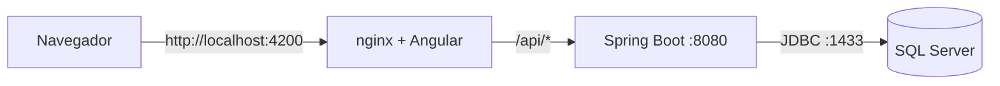
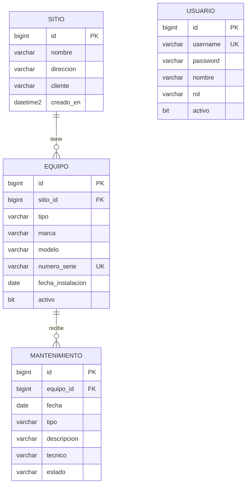
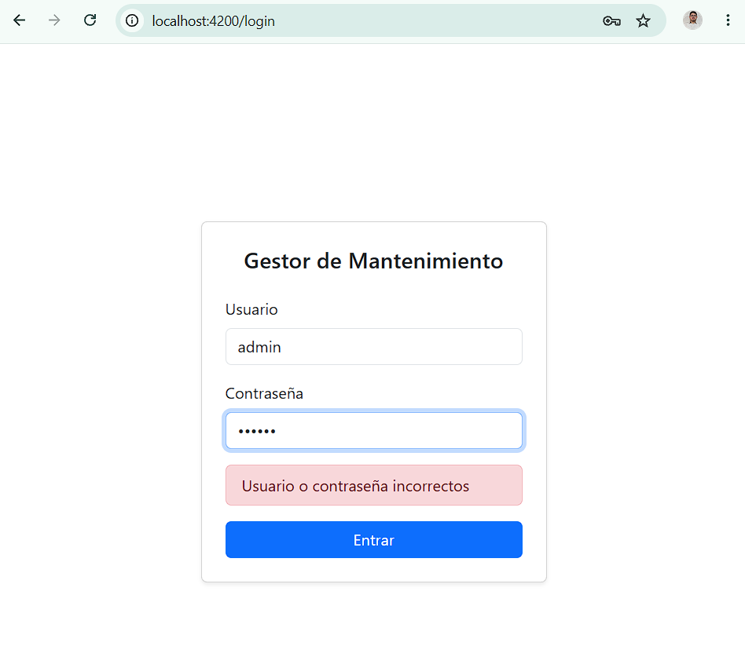
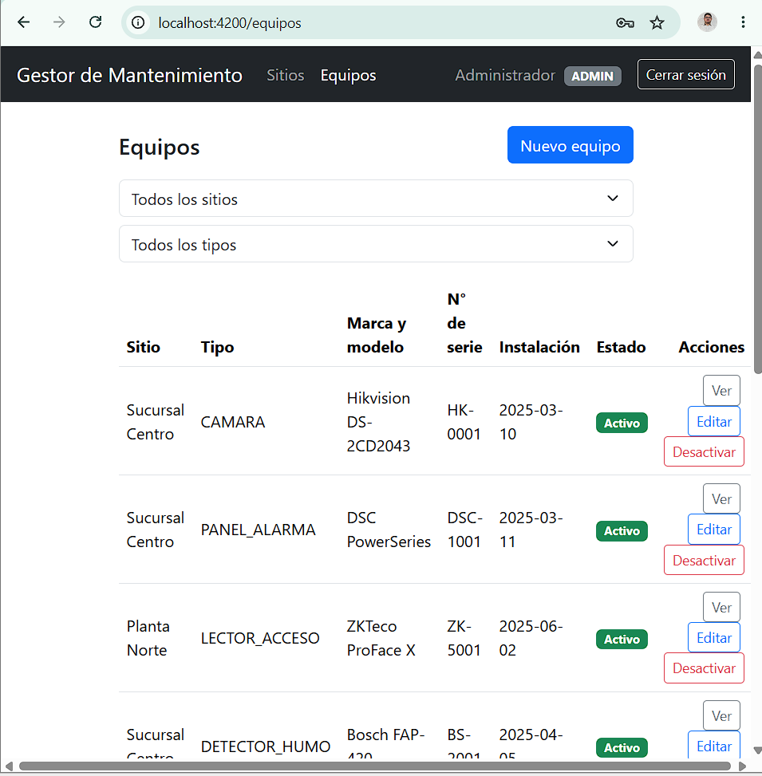
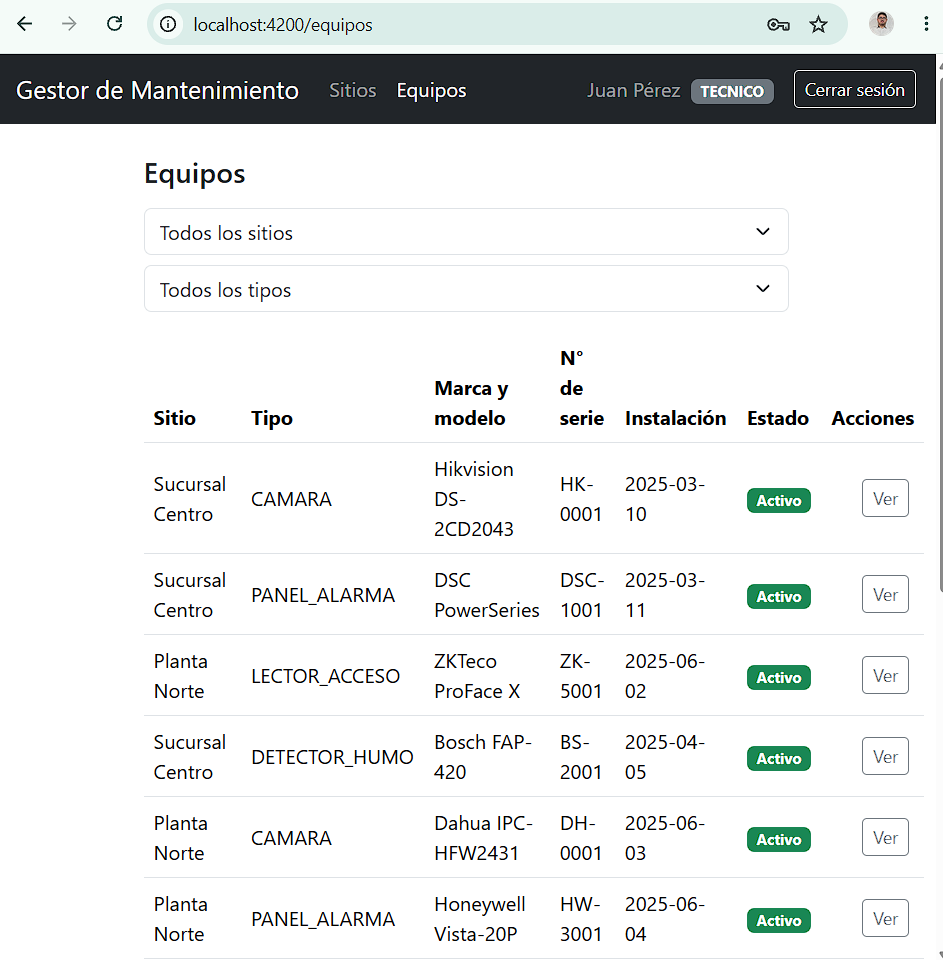
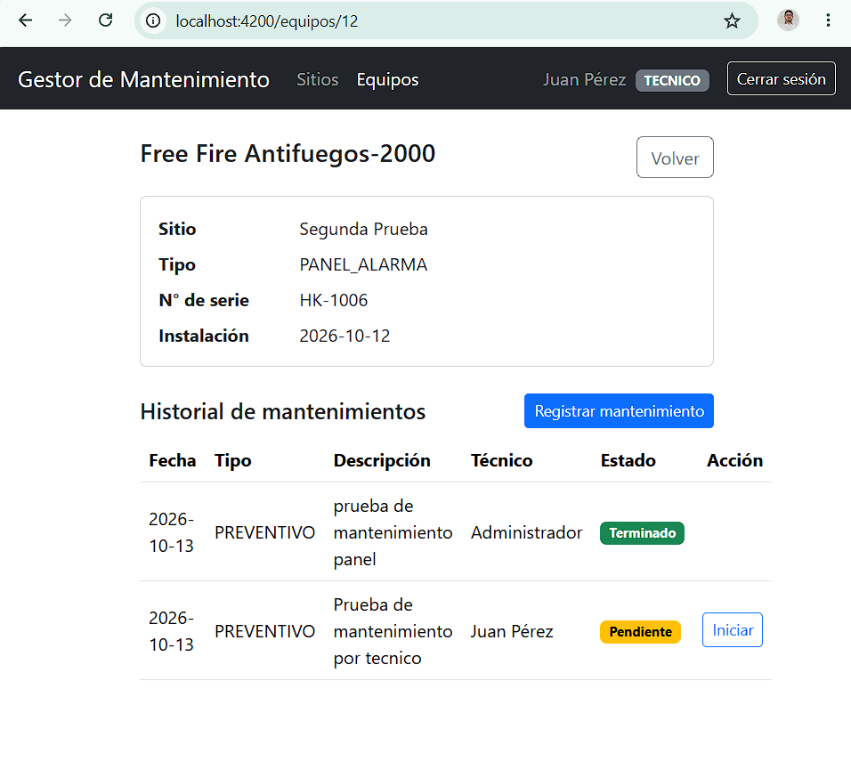
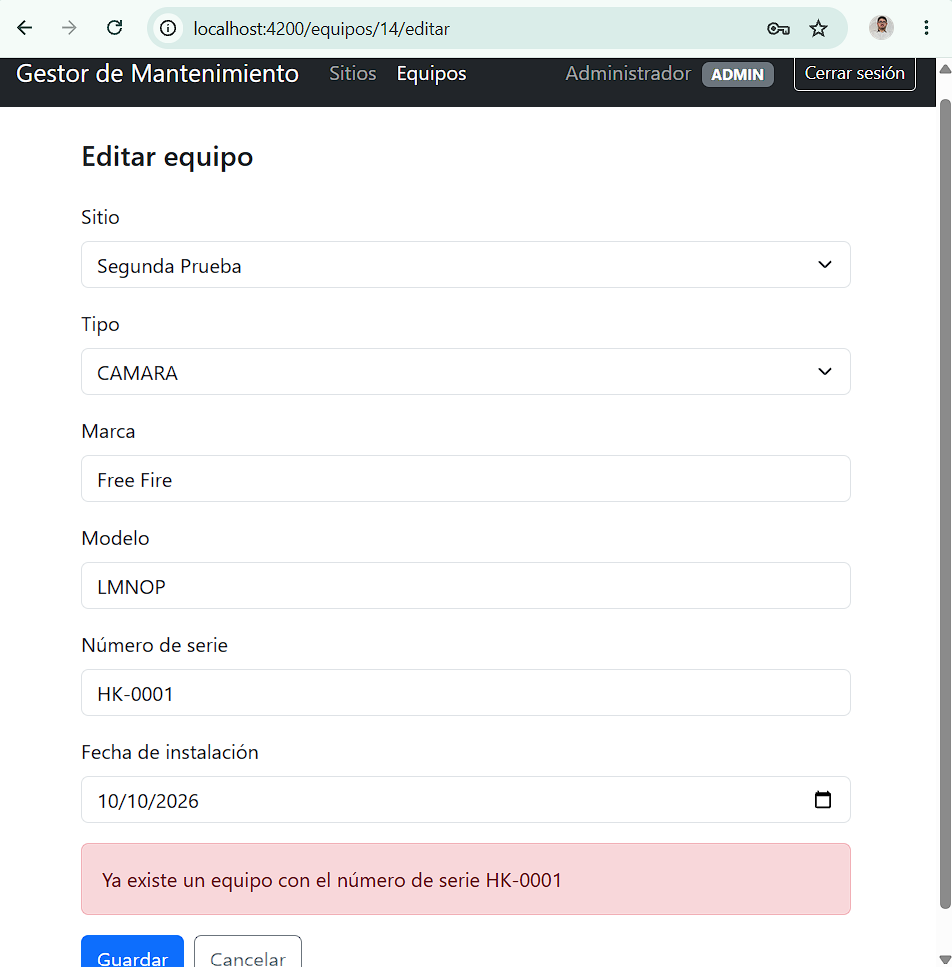
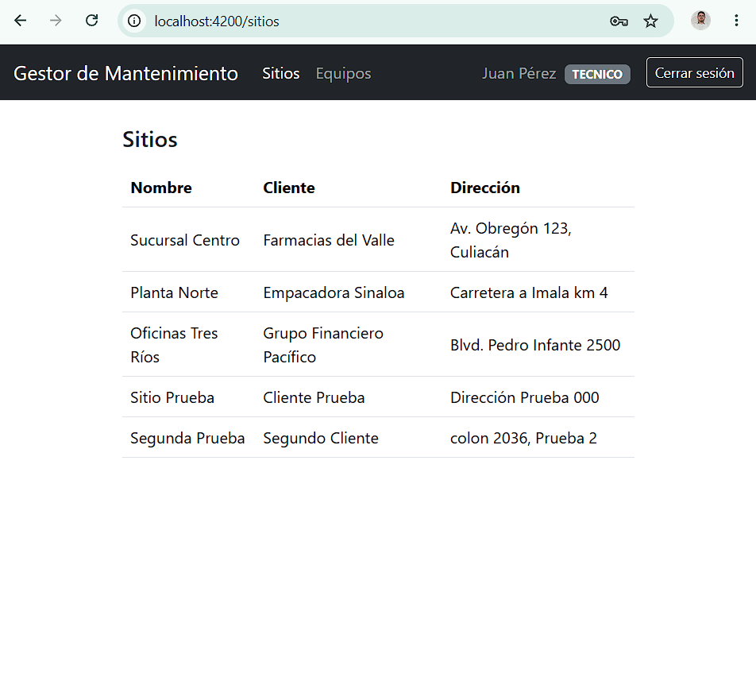

# Gestor de Mantenimiento

Sistema web para administrar el mantenimiento de equipos de seguridad (cámaras, paneles
de alarma, lectores de acceso y detectores de humo) instalados en los sitios de distintos
clientes. Reemplaza el control en hojas de cálculo: cada equipo conserva su historial de
mantenimientos, el estado de cada intervención avanza de forma controlada y cada rol ve y
hace solo lo que le corresponde.

## Tecnologías

| Capa | Tecnología | Versión |
|---|---|---|
| Frontend | Angular, TypeScript, Bootstrap |Angular 22.2.0 Bootstrap v5.3.8 |
| Servidor web | nginx (sirve Angular y reenvía `/api`) | alpine |
| Backend | Java, Spring Boot, Spring Data JPA, Spring Security | Java 21, Spring Boot 4.1.1 |
| Autenticación | JWT con jjwt, contraseñas con BCrypt | jjwt 0.12.6 |
| Base de datos | SQL Server | 2022 |
| Contenedores | Docker y Docker Compose | Docker 29.8.0 Docker compose v5.5.1 |
| Pruebas | JUnit 5, Mockito, Postman | |

## Arquitectura



El navegador solo habla con nginx. Este sirve los archivos de Angular y reenvía las rutas
`/api/` al backend, por lo que en Docker todo queda en un solo origen (sin problemas de CORS).

### Modelo de datos



`USUARIO` no se relaciona con las demás tablas: solo sirve para la autenticación y los roles.

## Cómo correrlo (Docker)

Solo necesitas **Docker Desktop**.

1. Clona el repositorio y entra a la carpeta.
2. Crea tu archivo de variables:
```bash
   cp .env.example .env
```
3. Edita `.env`:
   - `MSSQL_SA_PASSWORD` y `DB_PASSWORD`: contraseñas de al menos 8 caracteres con
     mayúsculas, minúsculas, números y símbolos (sin comillas ni `$`).
   - `JWT_SECRET`: genera uno con `openssl rand -base64 32`
     (o `node -e "console.log(require('crypto').randomBytes(32).toString('base64'))"`).
4. Levanta todo:
```bash
   docker compose up -d --build
```
5. Abre **http://localhost:4200**. La API queda también en http://localhost:8080.

La primera vez tarda unos minutos (descarga imágenes y compila). Para comprobar el estado:

```bash
docker compose ps -a     # db: healthy, db-init: Exited (0), backend y frontend: Up
```

Para apagar: `docker compose down` (conserva los datos) o `docker compose down -v`
(borra la base de datos).

## Modo desarrollo (fuera de Docker)

Levanta solo la base de datos:

```bash
docker compose up -d db db-init
```

**Backend** (requiere JDK 21), con las variables del `.env` cargadas:

```bash
set -a; source .env; set +a
cd backend
./mvnw spring-boot:run
```

**Frontend** (requiere Node 22 y Angular CLI):

```bash
cd frontend
npm install
ng serve
```

La aplicación queda en http://localhost:4200 y llama a la API en http://localhost:8080.
Si tienes todo el sistema levantado con Docker, detenlo antes: los puertos 4200 y 8080 se
repiten.

## Usuarios de prueba

Se crean automáticamente al primer arranque. **Solo para desarrollo.**

| Usuario | Contraseña | Rol |
|---|---|---|
| `admin` | `Admin123!` | ADMIN |
| `tecnico` | `Tecnico123!` | TECNICO |

## Endpoints

| Método | Ruta | Descripción | Rol |
|---|---|---|---|
| POST | `/api/auth/login` | Iniciar sesión y recibir el JWT | Público |
| GET | `/api/auth/me` | Datos del usuario autenticado | Ambos |
| GET | `/api/sitios`, `/api/sitios/{id}` | Consultar sitios | Ambos |
| POST, PUT, DELETE | `/api/sitios`, `/api/sitios/{id}` | Crear, editar y eliminar sitios | ADMIN |
| GET | `/api/equipos?sitioId=&tipo=` | Listar equipos con filtros | Ambos |
| GET | `/api/equipos/{id}` | Detalle de un equipo | Ambos |
| POST, PUT, DELETE | `/api/equipos`, `/api/equipos/{id}` | CRUD (DELETE = borrado lógico) | ADMIN |
| GET | `/api/equipos/{id}/mantenimientos` | Historial, del más reciente al más antiguo | Ambos |
| POST | `/api/equipos/{id}/mantenimientos` | Registrar un mantenimiento | Ambos |
| PUT | `/api/mantenimientos/{id}` | Editar (si no está TERMINADO) | ADMIN |
| PATCH | `/api/mantenimientos/{id}/estado` | Avanzar el estado | Ambos |
| GET | `/api/mantenimientos?estado=&desde=&hasta=` | Buscar por estado y fechas | Ambos |

Las rutas protegidas requieren `Authorization: Bearer <token>`. Sin token o con token
vencido responden **401**; con un rol insuficiente, **403**.

## Reglas de negocio

| # | Regla | Respuesta |
|---|---|---|
| R1 | El número de serie de un equipo es único | 409 |
| R2 | No se registra mantenimiento a un equipo inactivo | 409 |
| R3 | El estado solo avanza: PENDIENTE → EN_PROCESO → TERMINADO | 409 |
| R4 | Un mantenimiento TERMINADO no se edita | 409 |
| R5 | Los equipos se desactivan, no se borran. Un sitio solo se elimina si no tiene equipos | 204 / 409 |
| R6 | Un id inexistente responde 404 | 404 |
| R7 | Sin token, alterado o vencido | 401 |
| R8 | El TECNICO no crea, edita ni elimina sitios o equipos | 403 |
| R9 | Usuario inexistente y contraseña incorrecta dan el mismo mensaje | 401 |
| R10 | Las contraseñas se guardan con BCrypt y ninguna respuesta las devuelve | |
| R11 | Un usuario con `activo = false` no inicia sesión | 401 |

## Pruebas

- **Postman:** importa `backend/postman/gestor-mantenimiento.postman_collection.json`.
  Incluye el camino feliz, los casos de error y las reglas de seguridad (haz primero el
  login; el token se guarda solo).
- **Pruebas unitarias** (JUnit 5 y Mockito, sin base de datos):
```bash
  cd backend
  ./mvnw test -Dtest='*ServiceTest,EstadoMantenimientoTest'
```
- **Todas las pruebas**, incluida la de arranque de la aplicación, que requiere la base de
  datos y las variables del `.env`:
```bash
  set -a; source .env; set +a
  cd backend && ./mvnw test
```

## Capturas

| | |
|---|---|
|  |  |
|  |  |
|  |  |

## Decisiones técnicas

- **`ddl-auto=validate`:** las tablas las crean los scripts SQL de `database/`, que son la
  fuente de verdad del esquema. Hibernate solo verifica al arrancar que las entidades
  coincidan, así que un desajuste se detecta de inmediato y la aplicación nunca altera la
  base por su cuenta.
- **DTO en lugar de entidades:** la API no expone las entidades. Evita bucles de
  serialización entre `Equipo` y `Mantenimiento`, impide que el hash de la contraseña salga
  en una respuesta y separa lo que el cliente puede enviar de lo que el servidor asigna.
- **Borrado lógico de equipos:** al desactivar un equipo (en vez de borrarlo), su historial
  de mantenimientos se conserva.
- **JWT stateless:** el servidor no guarda sesiones; cada petición trae un token firmado
  (HMAC-SHA256) con el usuario, el rol y la expiración. CSRF está desactivado porque no se
  usan cookies de sesión.
- **BCrypt:** solo se guarda el hash de las contraseñas.
- **La regla de estados vive en el enum** (`EstadoMantenimiento.puedeCambiarA`): está en un
  solo lugar y se prueba sin base de datos.
- **Seguridad en dos capas:** la interfaz oculta botones y los guards redirigen, pero eso es
  solo comodidad. La seguridad real está en el backend, que valida firma, expiración y rol
  en cada petición.
- **nginx como proxy inverso:** el navegador solo conoce un origen, y la URL de la API en
  producción es la relativa `/api`.

## Qué mejoraría con más tiempo

- **Paginación y búsqueda por texto** en las listas (hoy devuelven todos los registros) y
  **carga diferida de rutas** en Angular para reducir el paquete inicial.
- **Gestión de usuarios** desde la interfaz, y cambio obligatorio de la contraseña inicial.
- **Contenedores más seguros:** ejecutar el backend sin `root` y añadir un *healthcheck*.
- **HTTPS** y gestión de secretos fuera del `.env`.
- **Auditoría:** registrar quién cambió el estado de cada mantenimiento y cuándo.
- **Integración continua** con GitHub Actions (compilar y probar en cada push).

## Estructura del repositorio

```
gestor-mantenimiento/
├── database/    scripts SQL de inicialización (esquema, datos de ejemplo, consultas)
├── backend/     API REST con Spring Boot (Dockerfile y colección de Postman)
├── frontend/    aplicación Angular (Dockerfile y nginx.conf)
├── docs/        capturas de pantalla
├── docker-compose.yml
├── .env.example
└── README.md
```